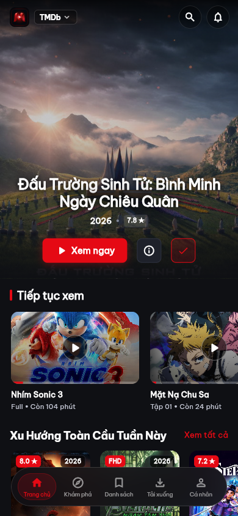
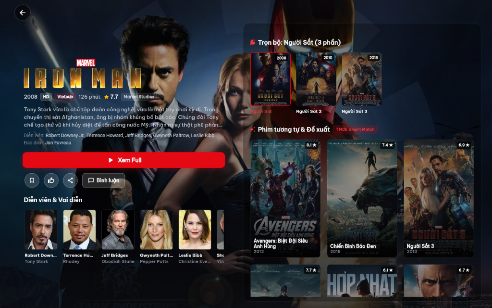
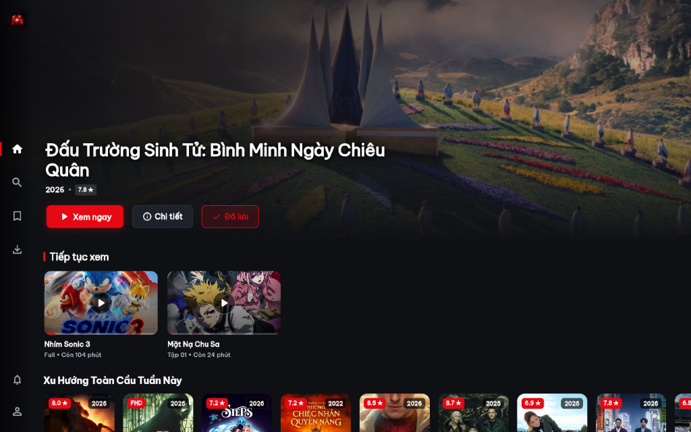

<div align="center">
  
  <h1>Movix</h1>
  <p><b>Ứng dụng xem phim trực tuyến hiện đại, mượt mà và không quảng cáo đa nền tảng được xây dựng bằng Flutter.</b></p>

  <p>
    <a href="https://github.com/phanan04/Movix/releases"></a>
    
    
    
  </p>

  <h4>📦 Tải ứng dụng (Bản cài đặt trực tiếp)</h4>
  <a href="https://github.com/phanan04/Movix/releases/latest">
    
  </a>
  <br>
  <sub>Hỗ trợ cài đặt trực tiếp file APK cho điện thoại Android, máy tính bảng và Android TV.</sub>
</div>

---

## ✨ Tính năng nổi bật

### ⚡ Chuyển đổi nguồn phim linh hoạt (TMDb / KKPhim)
- **TMDb (The Movie Database)**: Khám phá bom tấn điện ảnh quốc tế, series truyền hình ăn khách toàn cầu, bảng xếp hạng xu hướng trong 24 giờ qua và hồ sơ dàn diễn viên.
- **KKPhim**: Thưởng thức kho phim Vietsub Châu Á, phim bộ đang chiếu, phim lẻ và anime phong phú được cập nhật liên tục.
- Chuyển đổi 1 chạm tức thì ngay tại Logo ở góc màn hình.

### 🎨 Thiết kế giao diện hiện đại (iOS & Netflix Inspired)
- **Mobile Portrait**:
  - **Floating Pill Bottom Bar**: Thanh điều hướng nổi dạng viên thuốc lơ lửng phong cách iOS với hiệu ứng kính mờ (*Liquid Frosted Glass 30px*), viền tinh tế và phản hồi xúc giác rung nhẹ (`HapticFeedback`).
  - **Top Bar tràn viền trong suốt**: Tối ưu hiển thị ảnh nền Hero Banner đè lên status bar tạo cảm giác không viền sang trọng.
- **Tablet / Desktop Wide**:
  - **Transparent Rail Navigation**: Thanh rail bên trái chỉ icon lơ lửng trên ảnh nền phim, tối đa hóa tầm nhìn điện ảnh góc rộng.
  - Tự động co giãn lưới phim thông minh theo kích cỡ màn hình.

### 🎬 Trình phát video chuyên nghiệp (Movix Player)
- Hỗ trợ phát trực tiếp định dạng streaming tốc độ cao (HLS / m3u8).
- **Cử chỉ thông minh**: Chạm đúp 2 bên để tua nhanh/lùi 10 giây; nhấn giữ vào màn hình để tăng tốc xem x2 mượt mà.
- **Ghi nhớ tiến trình (Resume Playback)**: Tự động lưu và nhắc nhở xem tiếp chính xác từng giây.
- Tự động chuyển tiếp tập tiếp theo khi hết phim và hỗ trợ chuyển đổi đa Server nguồn phát khi có sự cố.

### 📌 Quản lý danh sách & Lịch sử thông minh
- Quản lý danh sách **Yêu thích (My List)** và **Lịch sử xem (History)**.
- **Chế độ chọn nhiều mục (Multi-select)**: Nhấn giữ vào phim bất kỳ để kích hoạt chọn 1, nhiều hoặc tất cả (`Select All`), xóa hàng loạt và tự động đồng bộ đám mây.

### 🚀 Tối ưu hiệu năng & Trải nghiệm chạm
- **Skeleton Shimmer**: Thay thế vòng xoay tải tròn bằng hiệu ứng khung xám lướt sóng, cho cảm giác phản hồi nhanh tức thì.
- **Press Scale Effect (0.96)**: Thẻ poster và các nút bấm co giãn nhẹ nhàng khi giữ và thả ngón tay.
- Tối ưu bộ nhớ đệm hình ảnh (`memCacheWidth` / `memCacheHeight`), giảm thiểu tối đa RAM và chống giật lag.

---

## 📱 Ảnh chụp màn hình

<div align="center">
  <table style="border: none; background: transparent;">
    <tr>
      <td align="center">
        <b>📱 Mobile Portrait (Pill Bar & Transparent Header)</b><br><br>
        
      </td>
      <td align="center">
        <b>🎬 Chi tiết phim & Diễn viên (Movie Detail)</b><br><br>
        
      </td>
    </tr>
    <tr>
      <td colspan="2" align="center">
        <br>
        <b>💻 Tablet & Desktop (Transparent Rail Overlay)</b><br><br>
        
      </td>
    </tr>
  </table>
</div>

---

## 🛠️ Công nghệ sử dụng

- **Ngôn ngữ & Framework**: [Flutter](https://flutter.dev) (Dart SDK >= 3.3.0)
- **Quản lý trạng thái (State Management)**: [Riverpod 2.x](https://riverpod.dev)
- **Xử lý mạng & Caching**: [Dio](https://pub.dev/packages/dio), [CachedNetworkImage](https://pub.dev/packages/cached_network_image)
- **Trình phát video**: [VideoPlayer](https://pub.dev/packages/video_player) / [Chewie](https://pub.dev/packages/chewie)
- **Lưu trữ cục bộ**: [SharedPreferences](https://pub.dev/packages/shared_preferences)
- **Dữ liệu phim**: [The Movie Database (TMDb) API](https://www.themoviedb.org/) & [PhimAPI](https://phimapi.com/)

---

## 🚀 Hướng dẫn cài đặt & Khởi chạy

### Yêu cầu môi trường
- Flutter SDK (Phiên bản 3.24 trở lên)
- Java 17 hoặc 21 (dành cho Android build)
- Trình duyệt Chrome hoặc thiết bị Android / máy ảo

### Các bước khởi chạy:

1. **Clone repository**:
   ```bash
   git clone https://github.com/phanan04/Movix.git
   cd Movix/app
   ```

2. **Cài đặt thư viện**:
   ```bash
   flutter pub get
   ```

3. **Chạy ứng dụng thử nghiệm**:
   ```bash
   # Chạy trên Trình duyệt Web
   flutter run -d chrome

   # Chạy trên thiết bị Android
   flutter run -d <device-id>
   ```

4. **Đóng gói file cài đặt (Release APK)**:
   ```bash
   flutter build apk --release
   ```
   *File APK xuất ra tại: `app/build/app/outputs/flutter-apk/app-release.apk`*

---

## ⚖️ Tuyên bố pháp lý & Bản quyền (Legal Disclaimer)

1. **Phi thương mại & Mã nguồn mở**: Dự án Movix được phát triển hoàn toàn với mục đích học tập, nghiên cứu kỹ thuật và sử dụng cá nhân phi lợi nhuận.
2. **Không lưu trữ nội dung**: Movix hoạt động như một trình duyệt chuyên dụng, không lưu trữ hay truyền phát bất kỳ tập tin âm thanh hoặc video có bản quyền nào trên máy chủ riêng. Toàn bộ thông tin và nguồn phát được tổng hợp từ các dịch vụ và API công khai trên Internet.
3. **Tôn trọng bản quyền**: Người dùng tự chịu trách nhiệm về hành vi sử dụng của mình phù hợp với luật sở hữu trí tuệ tại địa phương.

---

<div align="center">
  <sub>Được phát triển với niềm đam mê điện ảnh và công nghệ ❤️</sub>
</div>
